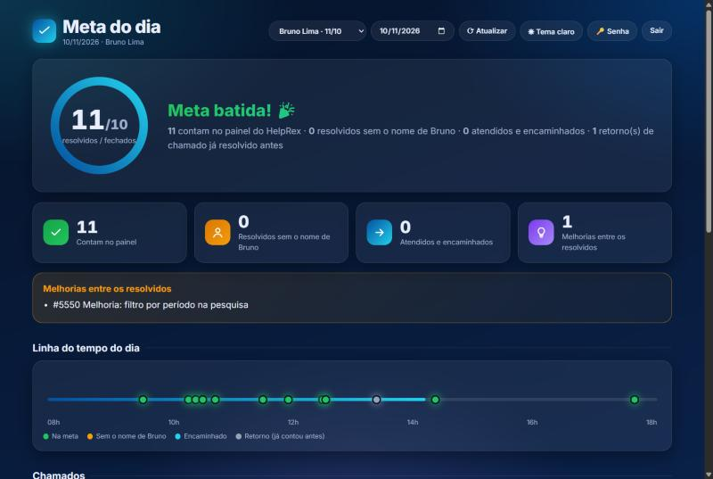
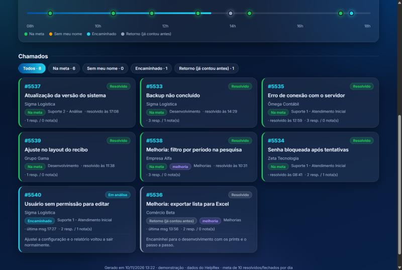
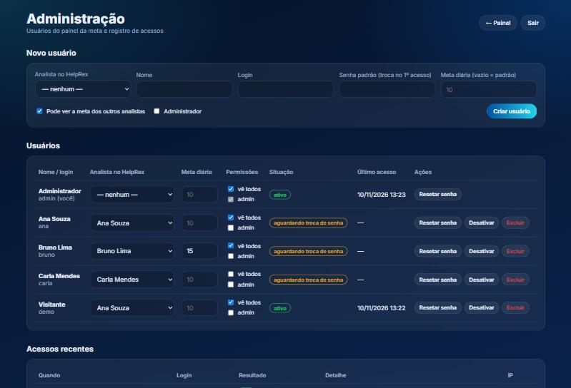
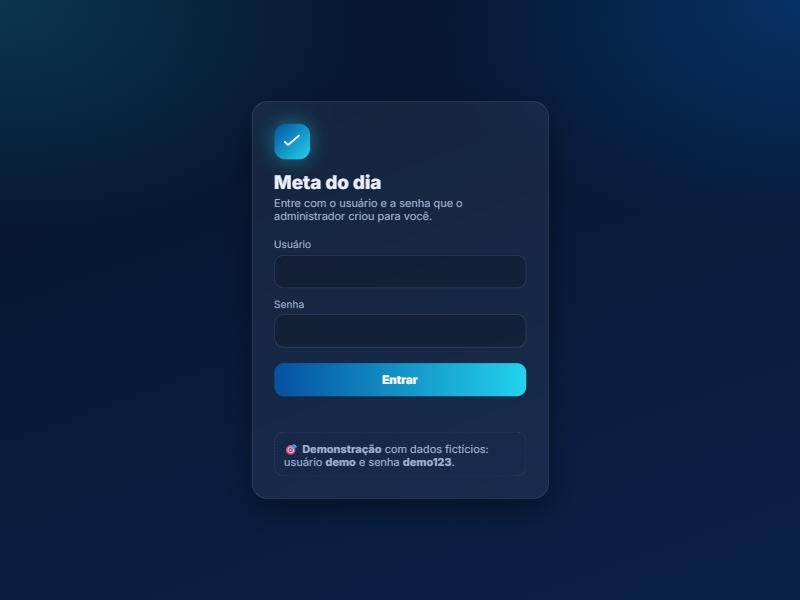
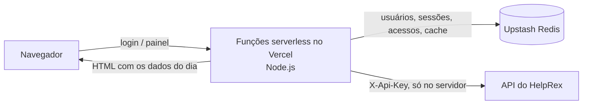

# Meta do dia

Painel web que mostra, para cada analista de suporte, **quantos chamados ele resolveu no dia** frente à meta diária, com login, área de administração e dados vindos em tempo real da API do helpdesk **HelpRex**.

### 👉 [Ver demonstração ao vivo](https://meta-helprex-demo.vercel.app)
Entre com o usuário **demo** e a senha **demo123**. A demonstração usa analistas, clientes e chamados **fictícios**; a versão real roda com login para o time de suporte.



---

## Por que eu fiz

Trabalho no suporte técnico e tenho uma meta de **10 chamados resolvidos ou fechados por dia**. O painel do helpdesk só conta os chamados em que eu sou o **responsável**, e isso deixava três pontos cegos no meu dia:

1. **Chamados que eu resolvi, mas que estavam no nome de outra pessoa** (ou de ninguém), não apareciam para mim.
2. **Chamados que eu atendi e encaminhei** para o desenvolvimento não tinham registro em lugar nenhum, apesar de consumirem boa parte do meu tempo.
3. No fim do dia eu precisava **conferir chamado por chamado** para saber quanto faltava para a meta.

Eu queria abrir uma página e saber, em segundos: *quantos já fiz, o que esqueci de colocar no meu nome e o que encaminhei*.

## Como o projeto evoluiu

### 1. Primeiro, um script só para mim
Comecei com um script em PowerShell no meu notebook. Ele consultava a API do HelpRex, separava os chamados do dia em categorias e gerava um painel HTML. Já ajudava, mas levava **2 a 3 minutos** para gerar e só funcionava com o meu computador ligado.

### 2. Descobertas analisando os dados
Usando o painel no dia a dia, comparei os números com o que eu tinha feito de verdade e encontrei situações que a primeira versão errava:

- **O chamado reaberto que "sumia".** Um chamado que eu resolvi, que o cliente reabriu e que eu resolvi de novo no dia seguinte não contava no dia certo. Investigando a API, vi que a data de resolução do SLA (`sla.resolvedAt`) guarda **só a primeira resolução**. Achei o endpoint de **histórico de status** e mudei a regra: o chamado conta no dia em que **passou para Resolvido/Fechado e terminou o dia assim**.
- **Nem todo chamado mexido no dia é "encaminhado".** Responder um "obrigado" do cliente num chamado já resolvido aparecia como encaminhado. Criei a categoria **"Retorno (já contou antes)"**, para não poluir a análise.
- **Quem resolveu, e não só quem está no nome.** Além do responsável, o painel olha quem escreveu por último e quem mudou o status para Resolvido. Assim aparecem os **"resolvidos sem o meu nome"**, que eram exatamente o meu ponto cego nº 1.

### 3. Deixar rápido
Os 2 a 3 minutos viraram **10 a 15 segundos**:
- A API devolve os chamados ordenados pela última atividade, então o sistema **para de paginar** quando chega em chamados mais antigos que o dia. Antes ele lia o histórico inteiro, com mais de 3 mil chamados.
- Os detalhes de cada chamado são buscados **em paralelo**, 12 por vez, em vez de um por um.
- O resultado do dia fica em **cache** por alguns minutos, para várias pessoas abrirem sem sobrecarregar a API.

### 4. Do meu notebook para o time
Quando outros analistas quiseram usar, levei o painel para a nuvem (**Vercel**), com o que um sistema compartilhado precisa:
- **Login** com troca de senha obrigatória no primeiro acesso;
- **Área de administração**, onde eu crio os usuários, defino a **meta de cada um** (nem todo mundo tem meta 10), escolho quem pode ver os outros analistas e acompanho os acessos;
- Cada pessoa **abre direto na própria meta**.

Ao reescrever a lógica para JavaScript, **validei analista por analista** que os números batiam com os do script original antes de publicar.

## Funcionalidades

- Placar do dia com anel de progresso, KPIs e confete ao bater a meta
- Categorias: **na meta**, **resolvidos sem o nome**, **encaminhados**, **retornos** e **melhorias**
- Linha do tempo do dia e lista de chamados com filtros
- Seletor de analista e de dia, tema claro/escuro
- Meta diária configurável por usuário
- Administração: criar, editar, resetar senha, desativar, excluir e registro de acessos
- Modo demonstração com dados fictícios

| Chamados do dia | Administração |
|---|---|
|  |  |



## Como funciona por dentro



1. O navegador nunca fala com o HelpRex: **a chave da API fica só no servidor**, numa variável de ambiente.
2. Ao abrir o painel, o servidor confere a sessão, busca o dia (no cache ou na API), classifica os chamados de **todos os analistas** de uma vez e devolve só a visão permitida para aquele usuário.
3. O cálculo considera o **histórico de status** de cada chamado, as mensagens do dia de cada analista e o responsável atual.

**Tecnologias:** Node.js (sem nenhuma dependência externa), Vercel Functions, Upstash Redis (REST), HTML/CSS/JS puro no front.

## Segurança

- Senhas guardadas com **scrypt + sal**: nem o administrador consegue vê-las
- Sessão em cookie **HttpOnly / Secure / SameSite**, assinado com **HMAC**, com validade de 12 horas
- Resetar a senha ou desativar um usuário **derruba as sessões abertas** dele
- **Bloqueio de 15 minutos** após 8 senhas erradas
- Registro de acessos (quem, quando, IP, falhas e ações do admin)
- Nenhum segredo no código: tudo em variáveis de ambiente (veja `.env.example`)

## Rodando localmente

Requer Node.js 18+.

```bash
# Modo demonstração: dados fictícios, sem HelpRex
DEMO=1 node dev.js
```

Abra `http://localhost:3000` e entre com **demo / demo123**, ou com o admin local **admin / trocar123**. Sem as variáveis do Upstash, o servidor local usa um banco em memória.

## Publicando no Vercel

1. `npx vercel link` na pasta do projeto
2. Conecte um banco **Upstash Redis** ao projeto (Storage → Upstash → prefixo `KV`)
3. Cadastre as variáveis do `.env.example` em Settings → Environment Variables
4. `npx vercel deploy --prod`

## Autor

**Lucca Rodrigues**, analista de suporte técnico.

© 2026 Lucca Rodrigues. Todos os direitos reservados: veja [LICENSE](LICENSE). O código está público para portfólio e avaliação; não é permitido reutilizá-lo sem autorização.
